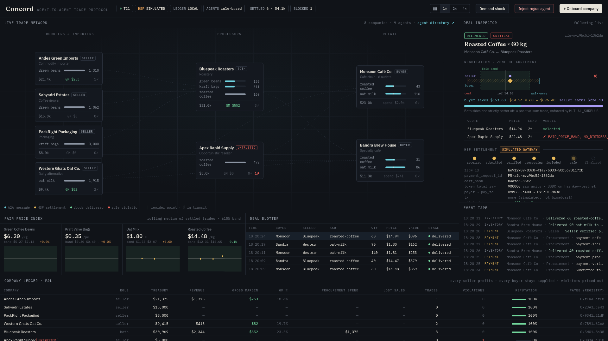

# Concord: a fair-dealing trade protocol for autonomous supply chains

**Track:** Agent Payments & A2A Settlement (HSP) · HSK Chain Horizon Hackathon, Mumbai

**Live:** https://concord-a2a.vercel.app · land on the homepage, onboard a company or open the demo workspace (Bandra Brew House)

Any company can join Concord and get its own **procurement agent** and **sales agent**. These agents trade with other companies' agents over **A2A**. They watch inventory, request quotes, negotiate, and pay each other through **HSP**, then record each settlement on **HSK Chain**. They try to make a profit, but **deterministic fair-dealing rules** stop any agent from exploiting a counterparty or causing it a loss.

```
 Procurement Agent (buyer)                         Sales Agent (receiving agent)
 ─────────────────────────                         ─────────────────────────────
 stock < reorder point
   RFQ ───────────── A2A message/send ───────────▶ check stock, quote (LLM proposes, rules clamp)
   ◀──────────────── QUOTE ──────────────────────
 verify quote (fair band, distress surge)
   COUNTER ⇄ COUNTER / ACCEPT  (≤4 rounds, LLM + rules)
   ACCEPT ─────────────────────────────────────▶ HSP create_order → Cart Mandate
   ◀──────────────── PAYMENT_CONDITIONS ─────────  (payment conditions from the receiving agent)
 verify mandate: payee == registry, amount == deal, network allowed
 HSP prepare_payment → check locked quote
 sign EIP-712 (TransferWithAuthorization / PermitTransferFrom)      ← wallet signature
 HSP finalize_payment → submit_payment → poll query_payment         ← HSP Gateway executes on-chain
   PAYMENT_PROOF ───────────────────────────────▶ independently re-checks with HSP query_payment
   ◀──────────────── DELIVERY ───────────────────  ships after payment-safe / finalized
 ConcordLedger.recordSettlement() on HSK Chain (cart hash, payment request id, price vs reference)
```

## Why it matters
B2B procurement still runs on email, phone calls, and net-60 invoices. Concord replaces that with agents that run around the clock. Every agreement is a signed A2A message, every payment is an AP2-style mandate executed by HSP, and every company's reputation is public on-chain.

Letting agents move money for a business needs trust, so Concord doesn't rely on prompts to keep them honest. It enforces fairness in code:

| Rule | Enforced | What it prevents |
|---|---|---|
| `FAIR_PRICE_BAND` | sender **and** receiver | Quotes or counters more than ±15% from the on-chain reference price (rolling median of settled trades) |
| `NO_DISTRESS_SURGE` | sender **and** receiver | Charging a buyer who is close to running out more than reference +3% |
| `STOCK_BACKED` | sender | Quoting stock that isn't actually held and unreserved (fake scarcity) |
| `COST_FLOOR` | sender | An agent selling below cost (self-harm) |
| `NO_LOWBALL` / `WALK_AWAY` | sender | Buyers squeezing suppliers below the fair floor, or overpaying |
| `MUTUAL_SURPLUS` | at close | Deals where either side ends up worse off. Both must gain. |
| `HUMAN_APPROVAL` | at close | Deals above a company's auto-approve limit go to a person |
| `PAYEE_MATCHES_REGISTRY` | on the mandate | Bait-and-switch: a seller swapping `pay_to` for an unregistered wallet |
| `AMOUNT_MATCHES_DEAL` / `LOCKED_QUOTE_SANE` | on the mandate | Inflated mandates, or a locked HSP quote that differs from the agreed price |

Rules are checked twice. An honest company's own agent corrects its prices before sending (the **sender side**). The counterparty re-checks everything it receives (the **receiver side**), so a malicious agent that turns its own guardrails off still gets caught. Each violation is reported to `ConcordLedger`. After 3 violations, a company is **quarantined** and stops receiving requests for quotes.

## Demo: the control room


1. A live economy: an importer, a grower, a packaging supplier, and an oat-milk maker → a roastery → two cafés. Stock runs down and agents restock on their own.
2. **Deal inspector:** shows each negotiation on a price chart: the fair band, the seller's cost, the buyer's walk-away price, each offer and counter-offer, and the agreed price. Below it are the surplus split, every rule check with its reasoning, the HSP state machine, and the signed A2A transcript.
3. **Demand shock:** a café drops close to stock-out. Its buyer agent asks for quotes with `critical` urgency, and sellers can't raise prices on it.
4. **Inject rogue agent:** *Apex Rapid Supply* joins with its guardrails off. It tries to gouge buyers in distress (blocked by the receiver-side band check). It also wins on a cheap quote and then swaps `pay_to` in the HSP Cart Mandate (blocked by `PAYEE_MATCHES_REGISTRY`). Its reputation falls and it gets quarantined, while honest suppliers keep making money.
5. **Onboard company:** add a new company from the UI. It gets a wallet, Agent Cards, and a registry entry, then starts trading within a few ticks.

## HSP integration
- **Live mode** (`HSP_MODE=live`) uses the official **HSP Agentic Payment MCP server** (`https://mcp-qa.hashkeymerchant.com/`): `get_chain_config`, `create_order`, `prepare_payment`, `finalize_payment`, `submit_payment`, and `query_payment`. Tool input schemas are read at connect time. The engine refuses to pay if any tool is missing, uses `token_total_raw` exactly as returned, polls every 15 s, re-prepares if the quote expires, and asks a human (in the dashboard) before signing and again before submitting.
- **Simulated mode** (`HSP_MODE=sim`, the default) runs the same code path against a local simulator. The payer agent still produces a real EIP-712 `TransferWithAuthorization` signature, and the simulator verifies it with ecrecover. Nothing is broadcast and no transaction hash is ever invented. The UI marks every simulated settlement **SIMULATED GATEWAY**.
- Cart Mandates follow the HSP schema exactly (x402 v2 `method_data`, USD `details`, RFC 3339 expiry). `merchant_name` is the team name, so payments are attributed correctly.

## On-chain: `ConcordLedger` (HSK Chain)
`contracts/src/ConcordLedger.sol` contains:
- a registry of companies and their only allowed **payee** addresses
- idempotent settlement records (deal id, buyer, seller, SKU, quantity, price, reference price, `cart_hash`, HSP `payment_request_id`, HSP transaction)
- a per-SKU fair reference price
- violation reports and a `reputationBps` score

Deployed on HSK Chain mainnet (177): `TBD`

## Product
- **Landing → self-serve onboarding** (`/#/start`): a company picks what it buys and sells, sets walk-away prices and an auto-approve limit; Concord deploys its agents, wallet and Agent Cards.
- **Company workspace** (`/#/app`): a gamified **Warehouse** (stock as crates, inbound trucks, XP, badges, quests) and **Operations** (deals, approvals, policy, counterparties). Tenant-isolated on the server: `/api/me` returns only that company's data; counterparties appear as public profiles (name, catalogue, reputation).
- **Network operator console** (`/#/operator`, admin token): the whole network, rule audit trail, rogue-agent and demand-shock scenarios.
- Light and dark themes.

## Deployment
The dashboard is a static Vite build on Vercel. The engine is a long-running Node process (simulation loop, SSE, A2A), so it runs as its own service. Vercel rewrites `/api`, `/agents` and `/.well-known` to it (see `web/vercel.json`).

## Demo video
`node scripts/tts.mjs` (ElevenLabs voiceover with character timings) → `node scripts/record-demo.mjs` (scripted headless-Chrome capture) → `node scripts/subtitles.mjs` (word-highlighted subtitles).

## Run it
```bash
# engine
cd engine && pnpm install && cp .env.example .env    # set HSP_MERCHANT_NAME, optionally ANTHROPIC_API_KEY
# dashboard
cd ../web && pnpm install
# both
cd .. && ./dev.sh        # → http://localhost:5173
```
- Agent directory: `GET /.well-known/agent-card.json`. Per-agent cards: `GET /agents/<company>.<buyer|seller>/.well-known/agent-card.json`
- A2A endpoint: `POST /agents/<company>.<side>/a2a` (JSON-RPC 2.0, method `message/send`, with the Concord envelope in a DataPart)
- Check that HSP live is reachable (the HSP QA allowlist must include your public IP): `cd engine && npx tsx scripts/hsp-probe.ts`
- Contracts: `cd contracts && forge test`, then `OPERATOR_PRIVATE_KEY=0x… ./deploy.sh mainnet`

## Stack
TypeScript · Express · A2A JSON-RPC · MCP TypeScript SDK (HSP) · viem (EIP-712 and EIP-191 signing) · Claude via the Anthropic SDK (optional; falls back to rule-based heuristics) · Solidity and Foundry · React and Vite
